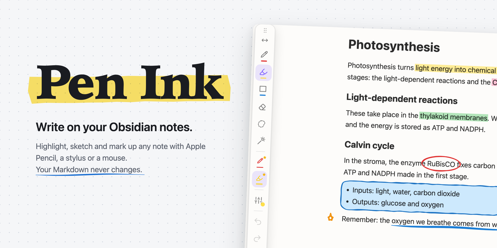
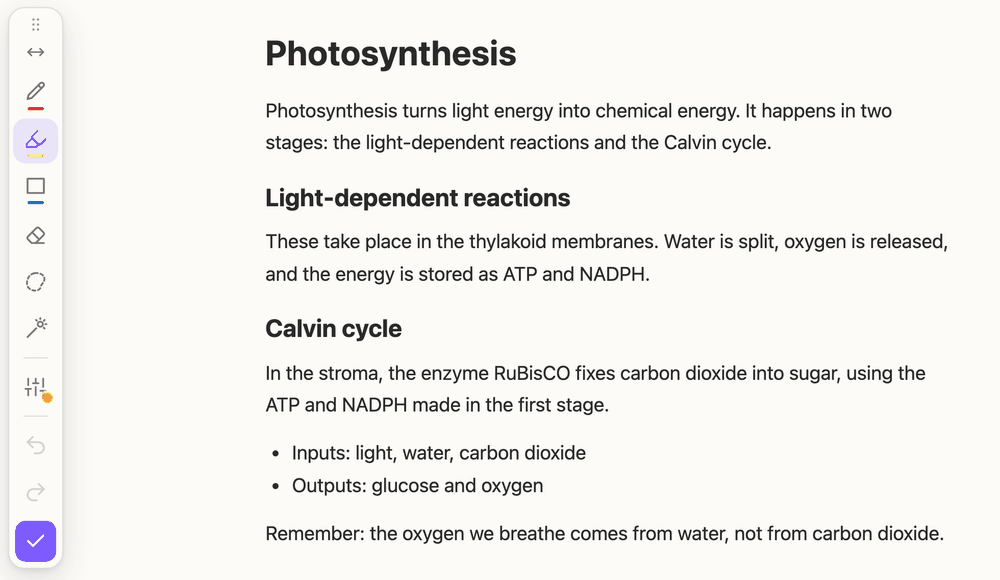
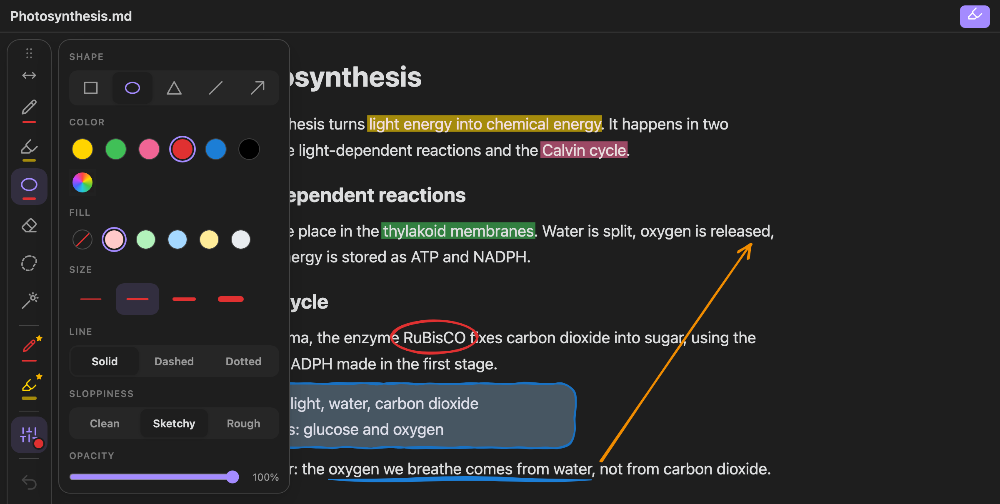
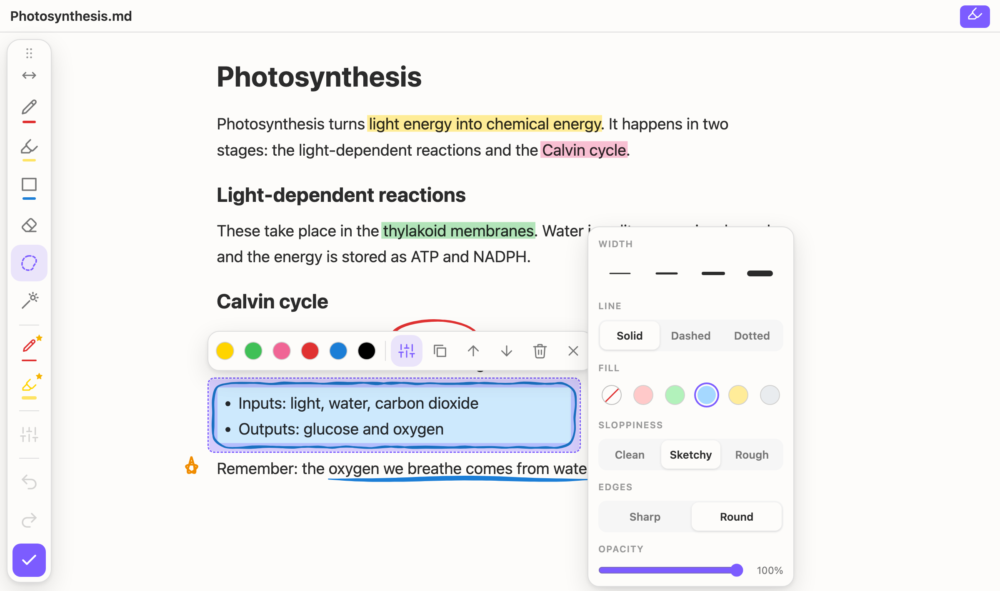

  

  
  
  
  

Pen Ink lets you write on your notes the way you would on paper. Circle the idea that matters, highlight the line
you'll want during review, sketch the diagram the text can't explain. Your ink floats over the note in reading view
and is saved in its own file, so the Markdown underneath stays exactly as you wrote it.

It's made for the iPad and Apple Pencil, and it works just as well with a mouse or another pen on desktop.

  

## Write and highlight

- **Ballpoint pen** in solid, dashed or dotted lines, in any color, at four sizes and any opacity.
- **Fountain pen** that follows your Pencil's pressure, thin on light strokes and full on firm ones.
- **Highlighter** that sits *behind* the text, so the words stay crisp instead of turning muddy.
- **Hold to straighten.** Pause at the end of a line and it snaps perfectly straight.
- **Smoothing** you can dial from "exactly what I drew" to "steady hand".
- **Erasers** that remove whole strokes or cut away only what you touch, with an optional pen-only or highlighter-only filter.

## Shapes with a hand-drawn feel

Rectangles, ellipses, triangles, lines and arrows. Press and drag. Near-squares snap to squares and near-circles to
circles. Give them a fill, pick clean, sketchy or rough lines, choose sharp or round corners, and set the opacity. They
look like they belong in a notebook, not a slide deck.

## Select, restyle, rearrange

Draw a loop around any ink to pick it up. Then move it, change its color, restyle its width, line, fill or edges,
duplicate it, bring it to the front, send it back, or delete it.

## At home on the iPad

- **Pencil draws, fingers scroll.** Rest your palm and swipe with a finger. Only the Pencil leaves ink.
- **Pinch to zoom** up to 4× for small, neat details. Ink is always saved at its real size. Tap the zoom badge to jump back to 100%.
- **Two-finger tap to undo**, plus undo and redo buttons.
- **Favorites.** Save up to six pen and highlighter setups and switch with one tap.
- **A toolbar that gets out of the way.** It docks as a column on the side; drag it anywhere or flip it into a row.
- **Laser pointer** with a fading trail for walking someone through a note. It's never saved.

On a Mac, a mouse draws, and a trackpad pinch or Ctrl/Cmd + scroll zooms.

## Your notes stay yours

Pen Ink never edits a note. Each note's ink is a small `.json` file in an **`Annotations`** folder that mirrors your
vault, for example `Annotations/Biology/Photosynthesis.json` for `Biology/Photosynthesis.md`.

- Rename or move a note and its ink moves with it.
- Ink is pinned to the paragraph you drew on, so it stays put when you scroll or when other parts of the note change.
- If you rewrite a paragraph, its ink is hidden (never deleted), since it may no longer line up.
- No network requests, no telemetry, no dependencies. It's one plain JavaScript file you can read end to end.

## Getting started

1. Install **Pen Ink** from **Settings → Community plugins → Browse**, then enable it.
2. Open a note and tap the **marker icon** in the note's header, or run **Pen Ink: Toggle annotation mode** from the command palette. The note switches to reading view and the toolbar appears.
3. Draw. Tap a tool a second time, or the **sliders** button, to change its color, size and style.
4. Tap **Done** (✓) when you're finished. Your ink is saved as you go.

## Settings

| Setting | What it does |
| --- | --- |
| Ink folder | Where drawings are saved. `Annotations` by default. |
| Hold to straighten | Pause at the end of a stroke to snap it straight. |
| Straight highlighter | Every highlight is drawn as a straight line. |
| Smoothing | From 0 (exactly what you draw) to 80 (very smooth). |
| Eraser switches back | After erasing, return to the pen you were using. |

## Devices

| Device | Status |
| --- | --- |
| iPad with Apple Pencil | Tested |
| Mac with mouse or trackpad | Tested |
| Android tablets with a stylus | Should work, not yet confirmed |
| Windows pen devices | Should work, not yet confirmed |
| iPhone | Should work, not yet confirmed |
| Linux | Should work, not yet confirmed |

If you try one of the unconfirmed setups, an [issue](https://github.com/zhuff99/pen-ink/issues) saying whether it
worked is a big help.

## Questions

<b>Does my ink sync between devices?</b>

Yes, if your sync tool syncs `.json` files. With Obsidian Sync, turn on **Settings → Sync → Sync all other types** on
every device. iCloud, Dropbox and Git sync them by default.

<b>Can I draw in Live Preview or Source mode?</b>

Pen Ink works in reading view, where the page holds still under your Pencil. Turning on annotation mode switches the
note to reading view for you.

<b>What if I uninstall the plugin?</b>

Your notes are untouched, because nothing was ever written into them. The ink files stay in the `Annotations` folder
until you delete them. Reinstall and point it at the same folder, and every drawing comes back.

## Installing by hand

Copy `main.js`, `manifest.json` and `styles.css` from the [latest release](https://github.com/zhuff99/pen-ink/releases/latest)
into `<your vault>/.obsidian/plugins/pen-ink/`, then enable **Pen Ink** in **Settings → Community plugins**.

## Development

Plain JavaScript, no build step and no dependencies.

- `node test/load.test.js` checks that the plugin loads against a minimal mock of the Obsidian API.
- `test/harness.html` is a fake reading view for the browser. Serve the repo folder (for example
  `python3 -m http.server`) and open `test/harness.html?test=1` to run the full set of scripted checks
  (pointer input, placement, tools, undo, performance). `test/harness.html?demo` shows the sample note used for the screenshots.

## License

[MIT](LICENSE)
